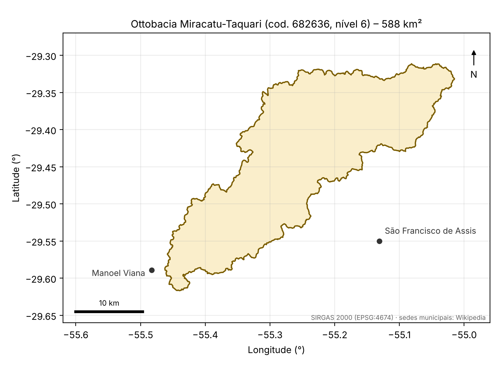

# Mapeamento de áreas de arenização com Sentinel-2 e Random Forest

> Projeto final do **Future Tech Leaders Brasil – Space Tech Bootcamp 2026**

**Autora:** Franqueline Monback Noschang – franqueline.noschang@gmail.com
**Mapa interativo:** https://franquinoschang.github.io/arenizacao-pampa/



## 1. Ideia do projeto

Mapear as **áreas de arenização (areais) existentes em 2025** na ottobacia **Miracatu-Taquari** (código 682636, entre Manoel Viana e São Francisco de Assis, sudoeste do RS), com imagens **Sentinel-2** e **Random Forest**.

**Problema.** A arenização é o principal processo de degradação do solo no Pampa gaúcho: em substratos arenosos frágeis, a perda da vegetação forma manchas de areia exposta. Os mapeamentos existentes usam imagens de 30 m ou classes genéricas de "área não vegetada", sem separar o areal de outros solos expostos, sobretudo da lavoura em preparo de solo, que tem resposta espectral parecida numa única data.

**Objetivo e produtos.** Inventário atualizado e aberto dos areais da ottobacia, em 10 m e com acurácia avaliada:

- mapa de classificação de 2025 (GeoTIFF)
- polígonos de areais (shapefile)
- código aberto e reprodutível
- mapa web no GitHub Pages.

## 2. Relevância para os ODS e para o ecossistema espacial

Metas oficiais em NAÇÕES UNIDAS BRASIL (s.d.).

- **ODS 15 – Vida Terrestre, meta 15.3:** o areal é a forma mais visível de degradação do solo no Pampa. O inventário mede a proporção da bacia degradada (5,0% em areal), a mesma ideia do indicador da meta, e mostra onde priorizar manejo e recuperação.
- **ODS 2 – Fome Zero e Agricultura Sustentável, meta 2.4:** a arenização reduz a área útil para a pecuária e a lavoura. O mapa mostra 8,2 km² de areal sobre lavoura do MapBiomas, e a conferência visual encontrou solo arenoso exposto em 42 de 50 manchas.
- **ODS 13 – Ação contra a Mudança Global do Clima, meta 13.1:** chuvas intensas abrem ravinas e voçorocas e o vento espalha a areia. O inventário de 2025 permite acompanhar essa resposta, repetindo o mesmo fluxo em outros anos.

**Contribuição prática.** O inventário serve de base de validação para mapas de suscetibilidade à arenização e oferece ao ecossistema geoespacial um fluxo aberto e reprodutível para mapear areais com Sentinel-2.

## 3. Literatura de referência

- **Souza e Pires (2017)** mapearam os areais do Arroio Puitã (1984–2014) com Landsat e Máxima Verossimilhança e usaram uma imagem por ano. A transição campo–areal, de vegetação rala, foi classificada como solo exposto, com resposta espectral parecida com a de solo em cultivo inicial. É a referência regional e mostra a lacuna abordada: data única e 30 m.
- **Rayne et al. (2023)** detectaram campos desertificados em Marrocos com Sentinel-2, Google Earth Engine e Random Forest, com 74–76% de acurácia na classe de desertificação. É a referência metodológica e o parâmetro realista de acurácia.

## 4. Área de estudo

| Item | Valor |
|---|---|
| Ottobacia | Miracatu-Taquari (Arroio Miracatu e Arroio Taquari) |
| Código / nível (ANA) | 682636 / 6 |
| Área | 588 km² |
| Municípios | Manoel Viana e São Francisco de Assis – RS |
| Bioma | Pampa |
| Sistema de referência do limite | SIRGAS 2000 (EPSG:4674) |
| Sistema das saídas | SIRGAS 2000 / UTM 21S (EPSG:31981) |

Segundo o MapBiomas 10 m (2025), a bacia tem 35,7% de campo, 28,7% de lavoura temporária, 15,9% de formação florestal nativa, 6,6% de silvicultura, 6,4% de mosaico de usos e **4,1% de praia, duna e areal**.

## 5. Dados

Todos os dados são públicos, acessados pelo Google Earth Engine (GEE) ou por download direto.

| Dado | Fonte | Formato | Uso |
|---|---|---|---|
| Sentinel-2 L2A, reflectância de superfície (`COPERNICUS/S2_SR_HARMONIZED`), 87 cenas de 2025 | ESA/Copernicus, via GEE | Raster, 10–60 m | Índices espectrais e variáveis do modelo |
| Cloud Score+ (`GOOGLE/CLOUD_SCORE_PLUS/V1/S2_HARMONIZED`) | Google, via GEE | Raster | Máscara de nuvens |
| Limite da ottobacia 682636 (`data/raw/area_de_estudo.shp`) | ANA – Base Hidrográfica Ottocodificada | Shapefile | Recorte da área de estudo |
| MapBiomas 10 m, Coleção 4, 2025 | MapBiomas, via GEE | Raster, 10 m | Apoio à amostragem, controle de qualidade e comparação do mapa final |
| Mapeamento de areais do RS (2020), recortado na bacia (`data/raw/Areais_area_estudo_SEMA/areais.shp`, 173 polígonos, 28,4 km², não incluído no repositório) | SEMA-RS | Vetor | Apoio à localização dos areais, controle de qualidade e comparação do mapa final |
| Amostras rotuladas | Produzidas neste projeto | GeoJSON / Shapefile | Treino e teste |

**Areais da SEMA-RS.** São dados de terceiros e não estão no repositório. O mapeamento de areais do RS (2020) está em https://sema.rs.gov.br/areais. O recorte usado aqui é a camada de areais da área de estudo, salva como `data/raw/Areais_area_estudo_SEMA/areais.shp`. O arquivo é opcional: sem ele, o notebook pula o controle de qualidade e as comparações com a SEMA-RS.

### Camadas de apoio à coleta de amostras

Geradas por [`src/camadas_apoio.py`](src/camadas_apoio.py), recortadas na bacia (10 m, UTM 21S):

| Camada | Conteúdo |
|---|---|
| `sentinel2_rgb_mediana_2025.tif` | mediana Sentinel-2 de 2025 em cor natural |
| `sentinel2_rgb_2025_01_jan-fev.tif` … `_06_nov-dez.tif` | 6 medianas bimestrais em cor natural |
| `pilha_indices_bimestrais_2025.tif` | 19 bandas: NDVI, NDWI e BSI medianos de cada bimestre + frequência de solo exposto (inteiros × 10 000, nomes em [`pilha_indices_bimestrais_2025_bandas.csv`](data/processed/pilha_indices_bimestrais_2025_bandas.csv)) |
| `MapBiomas_ottobacia_682636.tif` | MapBiomas 10 m, Coleção 4, 2025 |

### Amostras

Polígonos rotulados por **interpretação visual** em SIG, sobre imagens de alta resolução, as medianas Sentinel-2 anual e bimestrais, a pilha de índices, o MapBiomas 10 m e o mapeamento da SEMA-RS (usados para localizar, nunca como rótulo direto).

| Arquivo | Conteúdo |
|---|---|
| `data/raw/amostras_2025.geojson` | coleta original: 1.573 polígonos (Areal 301, Campo 301, Lavoura 300, Silvicultura 301, Água 70, Vegetação Nativa 300) |
| `data/raw/amostras_2025_revisado.geojson` | após a revisão dos areais (seção 6): 1.529 polígonos (Areal 176, Campo 380, Lavoura 302, Silvicultura 301, Água 70, Vegetação Nativa 300). O campo `revisao` registra a decisão de cada areal original |
| `data/raw/Lavouras_correcao/lavouras.shp` | amostras de correção da subclasse 7 Lavoura exposta: 94 polígonos, coletados em talhões classificados como areal |

**Total usado no treino e no teste:** 1.529 polígonos revisados mais 94 de Lavoura exposta, 1.623 no total.

O notebook lê a lista `CAMINHO_AMOSTRAS` (arquivos e/ou pastas com `.geojson`, `.shp` ou `.gpkg`). A classe vem do campo `classe` (código) ou dos campos `Classname`/`Classvalue` do *Training Samples Manager* do ArcGIS.

## 6. Metodologia

**Ferramentas:** Python, com `earthengine-api`, `geemap`, `geopandas` e `scikit-learn`, e SIG (ArcGIS Pro ou QGIS) para a coleta das amostras.

```
Limite da ottobacia ─► Sentinel-2 L2A 2025 (87 cenas + máscara de nuvens)
                              │
                              ▼
                 Índices por cena: NDVI, BSI, NDWI, solo exposto
                              │
                              ▼
   Variáveis anuais por pixel: medianas das bandas, estatísticas do NDVI,
   BSI e NDWI medianos, frequência de solo exposto
                              │
   Amostras (SIG) ─► sobreposições resolvidas ─► controle de qualidade dos areais
                              │
                ┌─────────────┴─────────────┐
                ▼                           ▼
   70% treino: Random Forest +     30% teste: matriz de confusão,
   ajuste de hiperparâmetros       acurácia, precisão, recall, F1
   (validação cruzada espacial)    e importância por classe
                │
                ▼
   Mapa (GEE) + filtro de manchas ─► área por classe, comparação com MapBiomas e SEMA-RS,
   camadas de revisão ─► GeoTIFF, polígonos de areais e mapa web
```

### Variáveis

Por cena, depois da máscara de nuvens do Cloud Score+:

- **NDVI** = (NIR − Vermelho) / (NIR + Vermelho)
- **BSI** = ((SWIR1 + Vermelho) − (NIR + Azul)) / ((SWIR1 + Vermelho) + (NIR + Azul))
- **NDWI** = (Verde − NIR) / (Verde + NIR)
- **Solo exposto** = NDVI < 0,25, BSI > 0 e NDWI < 0 (a condição do NDWI impede que a água, com NDVI negativo e BSI positivo, conte como solo exposto)

Por pixel, no ano (14 variáveis):

| Variável | Descrição |
|---|---|
| `B2_med` … `B12_med` | mediana anual das bandas azul, verde, vermelho, NIR, SWIR1 e SWIR2 |
| `NDVI_min`, `NDVI_medio`, `NDVI_max` | NDVI mínimo, médio e máximo |
| `NDVI_amp`, `NDVI_desvio` | amplitude (máximo − mínimo) e desvio-padrão do NDVI |
| `BSI_med`, `NDWI_med` | BSI e NDWI medianos |
| `FREQ_EXPOSTO` | fração das cenas com solo exposto |

A frequência de solo exposto mede a persistência da exposição (o areal fica exposto em boa parte do ano, na mediana em metade das cenas, contra 13% na lavoura, exposta sobretudo no preparo do solo). As estatísticas do NDVI descrevem o ciclo da lavoura, que alterna solo exposto e vegetação densa.

### Classes

**Mapa final:** 1 Areal · 2 Campo · 3 Lavoura · 4 Silvicultura · 5 Água · 6 Vegetação Nativa (mata ciliar e capões).

**Subclasse de treino 7 – Lavoura exposta.** Talhões expostos na maior parte do ano (pousio, palhada, cantos de pivô) têm comportamento anual parecido com o do areal e eram confundidos com ele. Eles entram no treino como uma subclasse, para que o modelo aprenda essa assinatura separada da lavoura com ciclo de safra, e são juntados à Lavoura no mapa final. As métricas são calculadas com as classes do treino e com as classes do mapa.

### Coleta e controle de qualidade das amostras

Cada polígono representa a mesma classe o ano todo, conferido nas 6 imagens bimestrais e na pilha de índices, longe de bordas e de mudanças de uso. O **areal**, objeto do estudo, segue um critério mais rígido:

1. **Em SIG:** só é desenhado onde há areia exposta em todas as imagens bimestrais, confirmada na imagem de alta resolução, de preferência no núcleo do areal.
2. **No notebook:** em cada polígono de areal são medidas a frequência de solo exposto e o NDVI médio. São **núcleos de areal** os com frequência ≥ 0,50 e NDVI médio ≤ 0,30, e os demais são **duvidosos**. O resultado, com a concordância com o MapBiomas e a SEMA-RS, vai para `data/processed/qc_areais_2025.csv`.

**O controle de qualidade nunca filtra o teste.** O critério usa variáveis do próprio modelo, e tirar os duvidosos do teste deixaria só os casos fáceis e inflaria a acurácia do areal. Com `FILTRO_AREAIS_DUVIDOSOS = "nenhum"` (padrão), ele é só diagnóstico. Com `"so_treino"`, os duvidosos saem apenas do treino.

**Revisão dos areais.** Na coleta original, 90 dos 301 polígonos de areal eram núcleos. Os 211 duvidosos foram revisados um a um sobre a imagem de alta resolução e as imagens bimestrais, com o apoio de `revisao_areais_2025.shp`/`.csv` (status, variáveis, fração de areal no MapBiomas e prioridade de revisão) e `pixels_areais_duvidosos_2025.csv` (diagnóstico pixel a pixel):

| Decisão | Polígonos |
|---|---|
| Núcleo de areal, mantido | 90 |
| Duvidoso confirmado como areal | 86 |
| Reclassificado como Campo | 79 |
| Reclassificado como Lavoura | 2 |
| Removido | 44 |

**Sobreposições.** Polígonos de classes diferentes que se sobrepõem dariam dois rótulos ao mesmo pixel. Vale o arquivo listado depois em `CAMINHO_AMOSTRAS` (as camadas de correção ficam no fim da lista). O polígono anterior é removido, e a remoção é listada na saída do notebook.

### Treino e avaliação

- **Grupos espaciais:** polígonos da mesma classe que se tocam ou estão a menos de 20 m formam um grupo, que vai inteiro para o treino ou para o teste. Assim, pixels vizinhos quase idênticos não ficam dos dois lados.
- **Divisão 70/30** por grupo, estratificada por classe (`StratifiedGroupKFold`), antes do sorteio dos pontos.
- **Pontos:** até 20 por polígono, proporcionais à área, limitados a 600 por classe (420 no treino e 180 no teste), para que as classes pesem igual.
- **Ajuste de hiperparâmetros** (número de árvores, profundidade máxima, variáveis por divisão) por validação cruzada espacial de 5 dobras, com F1 macro como métrica.
- **Avaliação** no teste: matriz de confusão, acurácia global, precisão, recall, F1 e importância das variáveis por classe (por permutação).
- **Classificação** da bacia no GEE (`smileRandomForest`) com os mesmos hiperparâmetros e pontos de treino. A acurácia é conferida nos mesmos pontos de teste. O mapa é salvo como asset com uma assinatura das amostras e do modelo e reaproveitado enquanto nada mudar, o que evita reprocessar a bacia a cada etapa. Se o projeto do Google Cloud não tiver armazenamento de assets, o mapa é calculado sob demanda.
- **Filtro de manchas pequenas:** depois da classificação, manchas de Silvicultura e de Vegetação Nativa menores que 1 ha (as duas classes trocavam pixels soltos entre si) e de Água menores que 0,2 ha passam para a classe predominante ao redor. Uma mata nativa pequena só vira silvicultura se estiver dentro de um talhão, para não apagar capões. Areal, Campo e Lavoura não são filtrados, para manter os pequenos focos de areal.

**Por que Random Forest.** É uma classificação de pixels com poucas centenas de polígonos rotulados e variáveis tabulares: o Random Forest funciona bem nesse cenário, é robusto a variáveis correlacionadas, indica a importância das variáveis e roda nativamente no GEE. Deep Learning exigiria um grande volume de imagens rotuladas, que não existe para areais.

### Camadas de revisão

Além do mapa, o notebook exporta duas camadas para verificação em SIG:

- `conferencia_conflitos_2025.shp`: manchas onde o mapa e o MapBiomas discordam (areal × lavoura, água × outras classes, campo × areal)
- `revisao_areais_mapa_2025.shp`: cada mancha de areal do mapa, com a fração de areal e de lavoura no MapBiomas, as variáveis médias e uma prioridade de verificação (1 = sobre lavoura do MapBiomas).

Amostras de correção desenhadas nas manchas erradas entram como um novo arquivo no fim de `CAMINHO_AMOSTRAS` e são divididas em treino e teste como as demais. Como foram coletadas onde o mapa errava, a acurácia das classes que elas alimentam mede a separação desses casos difíceis, não a acurácia do mapa inteiro. É o caso da subclasse 7 (Lavoura exposta): ela vem só de `Lavouras_correcao/lavouras.shp` e tem 180 pontos no teste.

## 7. Estrutura do repositório

```
arenizacao-pampa/
├── data/
│   ├── raw/          # limite da ottobacia (ANA), amostras rotuladas e amostras de correção
│   └── processed/    # tabelas geradas (as imagens .tif ficam fora do Git)
├── notebooks/
│   └── 01_pipeline_arenizacao.ipynb
├── src/
│   ├── camadas_apoio.py   # camadas de apoio à coleta de amostras
│   └── pagina_web.py      # página web (mapa e relatório)
├── figures/          # mapas e gráficos
├── docs/             # mapa web (GitHub Pages)
├── DESIGN.md         # identidade visual da página web
├── pyproject.toml    # ambiente uv
├── requirements.txt  # alternativa ao uv
└── README.md
```

## 8. Instalação

Requisitos: Git, [uv](https://docs.astral.sh/uv/) (ou pip), Jupyter e uma conta no [Google Earth Engine](https://earthengine.google.com/) vinculada a um projeto do Google Cloud com a API do Earth Engine ativada.

```bash
git clone https://github.com/Franquinoschang/arenizacao-pampa.git
cd arenizacao-pampa
uv sync
uv run earthengine authenticate
```

Sem uv: `python -m venv .venv`, ative o ambiente e rode `pip install -r requirements.txt`.

Para usar outro projeto do Google Cloud, troque `PROJETO_GCP` no notebook e em `src/camadas_apoio.py`.

## 9. Como executar

1. **Camadas de apoio:** `uv run python src/camadas_apoio.py` exporta as medianas RGB, a pilha de índices e o recorte do MapBiomas para o Google Drive.
2. **Amostras:** rotule os polígonos em SIG e liste os arquivos em `CAMINHO_AMOSTRAS`.
3. **Notebook:** execute `notebooks/01_pipeline_arenizacao.ipynb` em ordem.
   - As etapas 1 a 4 rodam sem amostras.
   - A etapa 8 salva o mapa como asset (`ASSET_MAPA`) e aguarda a exportação. Nas execuções seguintes, sem mudanças nas amostras ou no modelo, o asset é reaproveitado. Sem armazenamento de assets no projeto, o mapa é calculado sob demanda, e a etapa 10 usa o GeoTIFF `classes_{ANO}.tif` baixado do Drive para `data/processed/`.
   - As exportações vão para a pasta `PASTA_DRIVE` do Google Drive.
   - A etapa 10 gera `docs/index.html`, publicável no GitHub Pages.

Todas as etapas aleatórias usam `SEMENTE = 42`. O processamento usa a cota não comercial do Earth Engine, e o asset do mapa e `EXPORTAR_VARIAVEIS = False` (padrão) reduzem o consumo.

## 10. Resultados

Arquivos gerados em `data/processed/` e `figures/`:

| Arquivo | Conteúdo |
|---|---|
| `qc_areais_2025.csv` | controle de qualidade de cada polígono de areal |
| `amostras_variaveis_2025.csv` | pontos de treino e teste com as variáveis |
| `ajuste_hiperparametros_rf.csv` | resultados da validação cruzada |
| `metricas_teste_2025.csv`, `metricas_teste_mapa_2025.csv` | métricas no teste (classes do treino e do mapa) |
| `metricas_teste_mapa_ee_2025.csv` | métricas do mapa publicado (Earth Engine, com o filtro) nos mesmos pontos de teste |
| `importancia_por_classe_2025.csv`, `figures/importancia_por_classe.png` | importância das variáveis por classe |
| `figures/matriz_confusao.png` | matriz de confusão no teste |
| `area_por_classe_2025.csv` | área de cada classe na bacia |
| `comparacao_mapbiomas_2025.csv` | área cruzada entre este mapa e o MapBiomas 10 m |
| `comparacao_sema_2025.csv` | classes deste mapa dentro e fora dos areais da SEMA-RS |

Os valores abaixo são da versão final do mapa (assinatura `c8d1f471198d`), com o filtro de manchas pequenas.

### Área por classe

| Classe | Área (km²) | % da bacia |
|---|---:|---:|
| **Areal** | **29,5** | **5,0** |
| Campo | 223,1 | 37,9 |
| Lavoura | 200,8 | 34,1 |
| Vegetação Nativa | 92,5 | 15,7 |
| Silvicultura | 35,0 | 5,9 |
| Água | 8,3 | 1,4 |

Para comparação, o MapBiomas 10 m (2025) tem 23,9 km² de areal na bacia (4,1%), e o mapeamento da SEMA-RS, 28,4 km².

### Acurácia no teste (30% das amostras, separadas por grupo espacial)

Mapa publicado (classificação do Earth Engine com o filtro de manchas), conferido nos 1.260 pontos de teste:

| Classe | Precisão | Recall | F1 |
|---|---:|---:|---:|
| **Areal** | **0,88** | **0,89** | **0,88** |
| Campo | 0,71 | 0,76 | 0,73 |
| Lavoura | 0,89 | 0,88 | 0,89 |
| Silvicultura | 1,00 | 0,97 | 0,98 |
| Água | 0,98 | 0,93 | 0,95 |
| Vegetação Nativa | 0,95 | 0,98 | 0,96 |

Acurácia global de **0,90** e F1 macro de **0,90**. O modelo do scikit-learn, sem o filtro, tem acurácia de 0,89 e F1 do Areal de 0,89 nos mesmos pontos. A classe mais difícil é o Campo, confundido com a Lavoura. Na validação cruzada, as 18 combinações de hiperparâmetros testadas ficaram entre 0,83 e 0,84 de F1 macro (± 0,02 a 0,03): o resultado depende mais das amostras e das variáveis do que do ajuste do modelo.

**Efeito do filtro de manchas pequenas.** O filtro eliminou quase todo o salpicado entre classes parecidas: as manchas de Silvicultura menores que 1 ha caíram de 12.723 para 184, e as de Água menores que 0,2 ha, de 8.073 para 47. A Silvicultura passou de 37,4 para 35,0 km² e a Água, de 10,9 para 8,3 km². O Areal, que não é filtrado, ficou praticamente igual (29,4 para 29,5 km²), e a acurácia global subiu de 0,89 para 0,90.

### Comparação com referências externas

A concordância geral com o MapBiomas 10 m é de 79% da área da bacia.

**Areal e MapBiomas 10 m (2025).**

- 13,6 km² do areal deste mapa também são areal no MapBiomas: 46% do areal mapeado e 57% do areal do MapBiomas.
- 8,2 km² (28%) do areal mapeado caem sobre lavoura do MapBiomas, 2,2 km² sobre *outras áreas não vegetadas* e 3,1 km² sobre *mosaico de usos*. O MapBiomas classifica o uso da terra: um talhão inteiro é lavoura, mesmo com uma mancha de areia dentro. Este mapa classifica a cobertura pixel a pixel, a 10 m. Na conferência visual de 50 polígonos de "Areal × Lavoura" (`conferencia_conflitos_2025.shp`), 42 de 50 (84%) correspondiam a manchas de solo arenoso exposto dentro das lavouras, áreas fragilizadas, com possíveis focos de arenização que as bases de referência não registram. Nas outras 8, a imagem não confirmou areia exposta. Os solos do substrato arenoso da bacia são "muito frágeis e altamente suceptíveis [sic] à erosão hídrica" (SUERTEGARAY, 2011, p. 69), e o processo "poderá ser desencadeado por agentes naturais ou atividades humanas" (SUERTEGARAY, 2011, p. 69). Parte da diferença ainda pode ser manejo (pousio, preparo do solo) ou talhões expostos por mais tempo que a lavoura comum, e a confirmação em campo é o próximo passo.
- 7,5 km² de areal do MapBiomas foram classificados como Campo neste mapa, sobretudo bordas e areais com vegetação rala.

**SEMA-RS.** 11,3 km² do areal deste mapa estão dentro dos areais da SEMA-RS (38% do areal mapeado e 40% da área da SEMA na bacia). Outros 11,1 km² dos areais da SEMA foram classificados como Campo, o que pode indicar recolonização vegetal desde o mapeamento da SEMA ou bordas com vegetação rala.

**Água.** Mesmo depois do filtro, o mapa tem 8,3 km² de água, contra 2,6 km² no MapBiomas. Quase toda a água do MapBiomas é encontrada (93%), mas há excesso em campo (1,8 km²), outras áreas (1,8 km²) e vegetação nativa (1,0 km²), provavelmente banhados, áreas úmidas e sombras de mata ciliar. Uma variável de frequência de água (fração das cenas com água) separaria os corpos d'água permanentes das áreas úmidas temporárias.

### Lição do processo

A primeira versão do mapa tinha acurácia de teste acima de 0,90, mas classificava 19% da bacia como areal. A comparação com o MapBiomas revelou o excesso. A revisão dos 211 polígonos de areal duvidosos (79 reclassificados como Campo, 44 removidos) e as amostras de Lavoura exposta reduziram o areal para 5,0% da bacia. **Uma acurácia alta no teste não garante um bom mapa:** o teste mede o modelo em amostras típicas, e a comparação com referências externas e a conferência na imagem medem o mapa inteiro.

## 11. Limitações e trabalhos futuros

- A resolução de 10–20 m não captura areais muito pequenos ou estreitos.
- Areais sob plantios de silvicultura não aparecem na imagem.
- As amostras vêm de interpretação visual, sem verificação de campo.
- A classificação é feita pixel a pixel: talhões expostos por mais tempo que a lavoura comum podem ter comportamento anual muito parecido com o do areal. Variáveis de textura ou a classificação por objetos (segmentação) podem reduzir essa confusão.
- A acurácia de teste vem de amostras escolhidas em áreas típicas de cada classe e tende a ser mais otimista que a acurácia do mapa inteiro, que inclui bordas e pixels mistos. Uma amostra de validação aleatória e estratificada sobre o mapa permite estimar a acurácia sem esse viés e corrigir a área por classe (Olofsson et al., 2014).
- O NDVI mínimo é sensível a nuvens residuais não removidas pela máscara.
- A Água ainda é maior que no MapBiomas (banhados, várzeas e sombras de mata ciliar). Uma variável de frequência de água separaria os corpos d'água permanentes das áreas úmidas temporárias.
- O mapa cobre um único ano (2025). Aplicar o modelo a anos anteriores permitiria medir a expansão dos areais.

## 12. Referências

- McFEETERS, S. K. The use of the Normalized Difference Water Index (NDWI) in the delineation of open water features. *International Journal of Remote Sensing*, v. 17, n. 7, p. 1425–1432, 1996. DOI: 10.1080/01431169608948714.
- MAPBIOMAS. Pampa – Appendix, ATBD Collection 11 e MapBiomas 10 m Collection 4. Código: github.com/mapbiomas/brazil-pampa. Disponível em: brasil.mapbiomas.org.
- NAÇÕES UNIDAS BRASIL. Objetivos de Desenvolvimento Sustentável. Disponível em: https://brasil.un.org/pt-br/sdgs.
- OLOFSSON, P.; FOODY, G. M.; HEROLD, M. et al. Good practices for estimating area and assessing accuracy of land change. *Remote Sensing of Environment*, v. 148, p. 42–57, 2014. DOI: 10.1016/j.rse.2014.02.015.
- RAYNE, L.; BRANDOLINI, F.; MAKOVICS, J. L. et al. Detecting desertification in the ancient oases of southern Morocco. *Scientific Reports*, v. 13, 2023. DOI: 10.1038/s41598-023-46319-1.
- RIKIMARU, A.; ROY, P. S.; MIYATAKE, S. Tropical forest cover density mapping. *Tropical Ecology*, v. 43, n. 1, p. 39–47, 2002.
- RIO GRANDE DO SUL. Secretaria do Meio Ambiente e Infraestrutura (SEMA). Mapeamento de areais do Rio Grande do Sul. 2020. Disponível em: https://sema.rs.gov.br/areais.
- ROUSE, J. W. et al. Monitoring vegetation systems in the Great Plains with ERTS. In: *Third ERTS Symposium*, NASA SP-351, p. 309–317, 1974.
- SOUZA, A. C.; PIRES, C. A. F. Dinâmica da arenização na bacia hidrográfica do Arroio Puitã, oeste do RS, através do mapeamento multitemporal no período de 1984 a 2014. *Revista Brasileira de Geomorfologia*, v. 18, n. 1, p. 185–196, 2017. DOI: 10.20502/rbg.v18i1.1051.
- SUERTEGARAY, D. M. A. *Deserto Grande do Sul: controvérsia*. Porto Alegre: Editora da UFRGS, 1992.
- SUERTEGARAY, D. M. A. Erosão nos campos sulinos: arenização no sudoeste do Rio Grande do Sul. *Revista Brasileira de Geomorfologia*, v. 12, n. 3, p. 61–74, 2011.

## 13. Licença

Código sob licença **MIT**. Dados produzidos neste projeto sob **CC BY 4.0**. Dados de terceiros seguem as licenças das respectivas fontes.

## 14. Agradecimentos

Future Tech Leaders Brasil, Agência Espacial Brasileira (AEB), SDG AI Lab, UNDP / ICPSD.
Emanuel Goulart, professor ao longo do curso.
Marco Antônio da Rosa Soares, amigo e apoiador do projeto.
Prof. Romário Trentin, orientador do mestrado, como referência e pela integração deste estudo à pesquisa sobre arenização.
