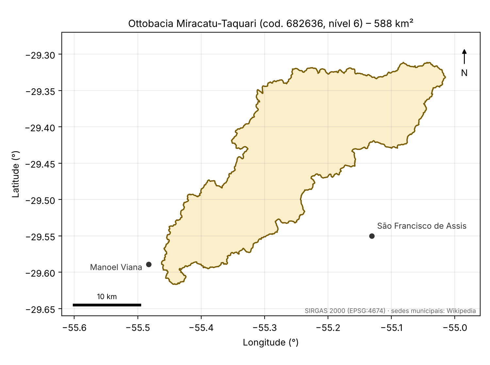

# Arenização no Pampa: mapeamento de areais com Sentinel-2 e Random Forest

> Projeto final (capstone) do **Future Tech Leaders Brasil – Space Tech Bootcamp 2026**

**Autora:** Franqueline Monback Noschang – franqueline.noschang@gmail.com
**Mapa interativo:** _em construção (GitHub Pages)_
**Dataset de amostras:** _em construção (Zenodo)_



## 1. Objetivo

Mapear as **áreas de arenização (areais) existentes em 2025** na ottobacia **Miracatu-Taquari** (código 682636, nível 6, 588 km²), entre Manoel Viana e São Francisco de Assis, sudoeste do Rio Grande do Sul. O mapeamento usa imagens Sentinel-2 e classificação supervisionada com Random Forest.

Perguntas do projeto:

1. Onde estão e quanto ocupam os areais da ottobacia em 2025?
2. Variáveis temporais dentro do ano (frequência de solo exposto, NDVI de verão e de inverno) separam o areal da lavoura em preparo de solo?
3. Qual modelo de machine learning tem o melhor desempenho nessa tarefa, avaliado com validação cruzada espacial?

O inventário de areais produzido aqui serve de base de validação para um mapa de suscetibilidade à arenização por análise multicritério (AHP), em desenvolvimento numa dissertação de mestrado.

## 2. Relevância

A arenização é o principal processo de degradação do solo no Pampa gaúcho: sobre arenitos friáveis (formações Botucatu e Guará), a perda da cobertura vegetal remobiliza a areia e forma manchas que dificultam a recolonização do campo.

- **ODS 15 – Vida Terrestre**, meta 15.3 (combater a degradação e restaurar solos degradados)
- **ODS 2 – Fome Zero e Agricultura Sustentável** (manejo do solo em áreas produtivas)
- **ODS 13 – Ação Climática** (linha de base para monitorar processos sensíveis a chuva e vento)

## 3. Área de estudo

| Item | Valor |
|---|---|
| Ottobacia | Miracatu-Taquari (Arroio Miracatu e Arroio Taquari) |
| Código / nível (ANA) | 682636 / 6 |
| Área | 588 km² |
| Municípios | Manoel Viana e São Francisco de Assis – RS |
| Suprabacia | Ibicuí–Santa Maria (Bacia do Rio Uruguai) |
| Bioma | Pampa |
| Sistema de referência do limite | SIRGAS 2000 (EPSG:4674) |
| Sistema das saídas | SIRGAS 2000 / UTM 21S (EPSG:31981) |

## 4. Dados

| Dado | Fonte | Formato | Uso |
|---|---|---|---|
| Sentinel-2 L2A, todas as cenas de 2025 (`COPERNICUS/S2_SR_HARMONIZED`) | ESA, via Google Earth Engine | Raster, 10–20 m | Índices e variáveis do modelo |
| Cloud Score+ (`GOOGLE/CLOUD_SCORE_PLUS/V1/S2_HARMONIZED`) | Google Earth Engine | Raster | Máscara de nuvens |
| Limite da ottobacia (`data/raw/area_de_estudo.shp`) | ANA – Base Hidrográfica Ottocodificada | Shapefile | Recorte da área de estudo |
| Amostras rotuladas (`data/samples/`) | Produzidas neste projeto | GeoPackage | Treino e validação |

Todos os dados de entrada são públicos.

## 5. Metodologia

```
Limite da ottobacia ─► Sentinel-2 2025 (todas as cenas + máscara de nuvens)
                              │
                              ▼
                 Índices por cena: NDVI, NDWI, BSI
                              │
                              ▼
   Variáveis anuais por pixel: medianas das bandas, NDVI p10/p50/p90,
   NDVI de verão e de inverno, frequência de solo exposto
                              │
   Polígonos de amostra ──► pontos ──► comparação de modelos (CV espacial)
                                              │
                                              ▼
                       Random Forest no Earth Engine ──► mapa de 2025
                                              │
                                              ▼
                 Área por classe + GeoTIFF e shapefile para o QGIS
```

**Classes:** 1 Areal · 2 Campo · 3 Lavoura · 4 Silvicultura · 5 Água

**Variável-chave:** a frequência de solo exposto ao longo do ano. O areal fica exposto o ano todo; a lavoura, só no preparo do solo.

**Validação:** treino e teste são separados **por polígono** (`StratifiedGroupKFold`), para evitar acurácia inflada por pixels vizinhos. Métrica principal: F1 macro. Também são reportados matriz de confusão, F1 por classe e importância das variáveis por permutação.

**Modelos comparados:** baseline Dummy, regressão logística, KNN, SVM, Gradient Boosting e Random Forest, seguindo a estrutura da aula *Machine Learning I* do [ebook do bootcamp](https://ftl-brazil-2026.github.io/ebook/).

## 6. Estrutura do repositório

```
arenizacao-pampa/
├── data/
│   ├── raw/          # limite da ottobacia (shapefile)
│   ├── samples/      # amostras rotuladas (GeoPackage)
│   └── processed/    # tabelas geradas pelos notebooks
├── notebooks/
│   └── 01_pipeline_arenizacao.ipynb
├── figures/          # mapas e gráficos
├── docs/             # página do GitHub Pages
├── src/              # funções reutilizáveis
├── pyproject.toml    # ambiente uv
├── requirements.txt  # alternativa ao uv
└── README.md
```

## 7. Instalação

Requisitos: Git, [uv](https://docs.astral.sh/uv/), VS Code com as extensões Python e Jupyter, e uma conta no [Google Earth Engine](https://earthengine.google.com/) vinculada a um projeto do Google Cloud (uso não comercial gratuito).

```bash
git clone https://github.com/Franquinoschang/arenizacao-pampa.git
cd arenizacao-pampa
uv sync
```

Sem uv: `python -m venv .venv`, ative o ambiente e rode `pip install -r requirements.txt`.

### Autenticação no Earth Engine

```bash
uv run earthengine authenticate
```

Depois, no notebook, troque `SEU-PROJETO-GCP` pelo ID do seu projeto do Google Cloud.

## 8. Como executar

1. Abra a pasta no VS Code e selecione o kernel do `.venv`.
2. Abra `notebooks/01_pipeline_arenizacao.ipynb`.
3. As etapas 1 a 4 rodam sem amostras e mostram o mapa da frequência de solo exposto.
4. As etapas 5 a 9 precisam de `data/samples/amostras_2025.gpkg` (polígonos com os campos `classe` e `poligono`).

Todas as etapas aleatórias usam `SEMENTE = 42`.

## 9. Resultados

_A preencher: mapa de classificação, comparação de modelos, matriz de confusão, importância das variáveis e área de areal na ottobacia._

## 10. Limitações

- A resolução de 10–20 m não captura areais muito pequenos ou estreitos.
- Areais sob plantios de silvicultura não aparecem na imagem.
- As amostras vêm de interpretação visual, sem verificação de campo.
- O mapa cobre um único ano (2025); a expansão ao longo do tempo fica como trabalho futuro.

## 11. Referências

- DE NARDIN, D.; ROBAINA, L. E. S. Zoneamento geoambiental no oeste do Rio Grande do Sul: bacia hidrográfica do Arroio Miracatu. *Geografia*, Rio Claro, v. 34, n. 1, p. 163–181, 2009.
- DUMMER, J.; VERDUM, R. Controle estrutural nos processos erosivos hídricos e na arenização, bacia hidrográfica do Arroio Miracatu – Rio Grande do Sul. *Revista Brasileira de Geomorfologia*, v. 24, 2023. DOI: 10.20502/rbg.v24i00.2318.
- SOUZA, A. C.; PIRES, C. A. F. Dinâmica da arenização na bacia hidrográfica do Arroio Puitã, oeste do RS, através do mapeamento multitemporal no período de 1984 a 2014. *Revista Brasileira de Geomorfologia*, v. 18, n. 1, p. 185–196, 2017. DOI: 10.20502/rbg.v18i1.1051.
- RAYNE, L. et al. Detecting desertification in the ancient oases of southern Morocco. *Scientific Reports*, v. 13, 2023. DOI: 10.1038/s41598-023-46319-1.
- MAPBIOMAS. Pampa – Appendix, ATBD Collection 11 e MapBiomas 10 m Collection 4. Código: github.com/mapbiomas/brazil-pampa.
- BREIMAN, L. Random Forests. *Machine Learning*, v. 45, p. 5–32, 2001.
- GORELICK, N. et al. Google Earth Engine: planetary-scale geospatial analysis for everyone. *Remote Sensing of Environment*, v. 202, p. 18–27, 2017.

## 12. Licença

Código sob licença **MIT**. Dados produzidos neste projeto sob **CC BY 4.0**. Dados de terceiros seguem as licenças das respectivas fontes.

## 13. Agradecimentos

Future Tech Leaders Brasil, Agência Espacial Brasileira (AEB), SDG AI Lab, UNDP / ICPSD.
